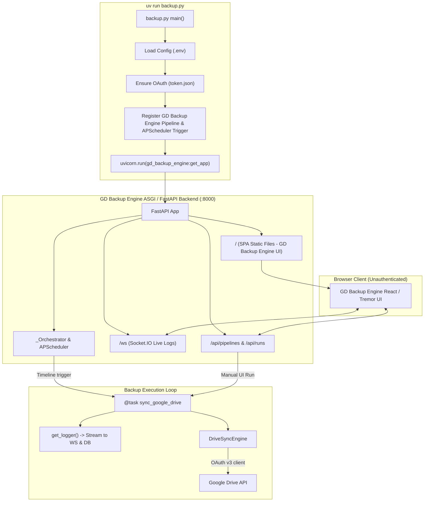

## Goal Capsule

- **Objective:** Automate directory backups from local storage to Google Drive on a scheduled timeline, while providing a web interface without authentication for schedule monitoring, execution history, live log streaming, and on-demand manual triggers.
- **Means:** Direct GD Backup Engine integration as orchestrator and UI framework running via `uv run backup.py` (KTD1).
- **Product Authority:** Active scope is the `gd-backup` local-to-Drive backup runner with GD Backup Engine UI. In-browser schedule editing, bi-directional sync, and remote file restoration are explicitly out of scope.
- **Open Blockers:** None.

---

## Product Contract

<!-- product-contract-preservation: Product Contract unchanged -->

### Summary

A Python backup service in `gd-backup` powered by GD Backup Engine and APScheduler that launches via `uv run backup.py`. It syncs files from a designated local folder to Google Drive on an APScheduler timeline configured directly in Python, while serving GD Backup Engine's web dashboard without authentication for schedule monitoring, execution history, live log streaming, and manual triggers.

### Problem Frame

Managing manual backups of local files to Google Drive is error-prone and lacks visibility into schedule status, run history, and real-time execution logs. Users currently have only raw scripts or cron jobs with no direct observability. This application wraps Google Drive backup automation in a local web interface that requires no login, giving operators instant visibility into upcoming runs, past run outcomes, live logs, and on-demand manual execution.

### Key Decisions

- **Direct GD Backup Engine integration as orchestrator and UI framework** (session-settled: user-directed — chosen over Standalone custom FastAPI app and Custom single-file UI: leverages GD Backup Engine to achieve exact UI layout, live WebSocket logs, and APScheduler execution with zero frontend duplication). Governs R1, R2, R3, R8, R9.
- **Directory sync as backup mechanism** (session-settled: user-directed — chosen over Timestamped archives and Single file upload: mirrors local files to Google Drive, updating or skipping existing files without inflating cloud storage with duplicate archives). Governs R5, R6.
- **Pure Python schedule configuration in `backup.py`** (session-settled: user-directed — chosen over Environment variable schedules and Presets: schedule timeline is explicitly declared using APScheduler trigger objects in code). Governs R3.
- **UI focused on monitoring, logs, and manual runs** (session-settled: user-directed — chosen over Full in-UI management and Status-only dashboard: keeps configuration in code/config while providing immediate manual trigger and observability in the browser). Governs R2, R4, R8, R9.
- **Folder and credentials configuration via environment with manual override support** (session-settled: user-directed — chosen over Auto-locate by name and Drive root directly: source directory and target folder ID configured in `.env`/code with parameter overrides on manual UI runs). Governs R4, R5, R7.

### Requirements

**Application Execution & Packaging**

- R1. The application must start both the scheduler and web server from a single entry point: `uv run backup.py`.
- R2. The application must serve the GD Backup Engine web interface on a local port (defaulting to 8000) accessible without any login or authentication barrier.

**Scheduling & Orchestration**

- R3. The backup schedule must be defined directly in Python inside `backup.py` using APScheduler trigger objects (such as `IntervalTrigger` or `CronTrigger`).
- R4. The web interface must provide a manual trigger control allowing users to execute an immediate backup on demand with optional input parameter overrides.

**Google Drive Backup Engine**

- R5. The backup engine must recursively synchronize files from the configured local source directory into the designated Google Drive folder.
- R6. The backup engine must inspect existing files in the target Google Drive folder and update modified file content rather than creating duplicate files.
- R7. Google Drive API authentication must use OAuth2 with `credentials.json` and `token.json`, supporting browser-based authorization on initial run and automatic token refresh on subsequent scheduled runs.

**Operational Visibility & Logging**

- R8. The application must stream execution logs in real time over WebSockets to the web interface during backup runs.
- R9. The web interface must display execution history for the backup pipeline, including run status badges (Success, Running, Failed), run duration, and timestamps.

### Key Flows

- F1. Scheduled Backup Execution
  - **Trigger:** APScheduler trigger fires according to configured timeline.
  - **Actors:** System Scheduler, Google Drive API.
  - **Steps:** Scheduler initiates backup task; backup engine reads local directory and Drive destination; new and modified files are uploaded; progress logs stream to WebSocket logger; run outcome and duration are saved in local database.
  - **Covered by:** R3, R5, R6, R8, R9.

- F2. Manual On-Demand Backup Run
  - **Trigger:** User clicks "Run" on the web interface.
  - **Actors:** User, Web UI, Backup Engine.
  - **Steps:** User opens `http://localhost:8000`, inspects current status, and triggers manual run with optional parameter overrides; backup executes immediately; live logs display in browser; run entry updates in history table.
  - **Covered by:** R2, R4, R5, R8, R9.

- F3. First-Time OAuth Consent
  - **Trigger:** Application starts without an existing `token.json`.
  - **Actors:** User, Google OAuth Client.
  - **Steps:** Google Auth launches local browser for OAuth consent; user grants file permissions; `token.json` is generated; application proceeds to schedule and serve UI.
  - **Covered by:** R1, R7.

### Acceptance Examples

- AE1. Automatic Scheduled Sync
  - **Covers:** R3, R5, R8, R9
  - **Given:** `backup.py` is running and an `IntervalTrigger(hours=6)` is active.
  - **When:** 6 hours elapse.
  - **Then:** Backup pipeline executes automatically, syncs local files to Google Drive, logs progress line-by-line, and records a successful run in the dashboard history.

- AE2. Manual Trigger via Web UI
  - **Covers:** R2, R4, R8
  - **Given:** User accesses `http://localhost:8000` without login credentials.
  - **When:** User clicks the "Run" button for the backup pipeline.
  - **Then:** Backup initiates immediately and the UI displays streaming log output.

- AE3. Conflict & Duplicate Prevention
  - **Covers:** R5, R6
  - **Given:** A file named `document.pdf` already exists in the destination Google Drive folder.
  - **When:** The local `document.pdf` is updated and a backup runs.
  - **Then:** The Google Drive API updates the existing file's media rather than creating a second file with the same name.

### Scope Boundaries

**Deferred for later**

- In-browser schedule / cron expression editor.
- Web-based Google Drive file explorer or restore/download tool.
- Failure notification alerts via Email or Slack.

**Outside this product's identity**

- User login, user accounts, and multi-tenant authentication.
- Bi-directional file synchronization (local files modified by Drive changes).
- Support for non-Google Drive cloud storage backends.

### Success Criteria

- SC1. Clean single-command startup: `uv run backup.py` initializes the scheduler and serves the web UI without manual build steps.
- SC2. Zero authentication friction: dashboard loads immediately without login or token prompts.
- SC3. Full operational observability: scheduled and manual runs stream real-time logs and populate execution history.
- SC4. Accurate cloud replication: local files are mirrored to Google Drive without duplicate file generation.

---

## Planning Contract

### Key Technical Decisions

- **KTD1. Link GD Backup Engine via local editable dependency in `pyproject.toml`** (session-settled: user-directed — chosen over Git dependency or vendored fork: allows direct imports from `gd_backup_engine` while referencing the local repository at `../gd_backup_engine`, utilizing its prebuilt static assets and FastAPI routers directly). Governs R1, R2.
- **KTD2. Single-process ASGI lifecycle via Uvicorn in `backup.py`**: The application starts as a unified ASGI process where FastAPI hosts both GD Backup Engine's REST routes (`/api`), Socket.IO WebSocket mount (`/ws`), static file delivery (`/`), and the APScheduler background runner. Governs R1, R2, R3, R8.
- **KTD3. Pydantic Settings for runtime configuration with Pydantic BaseModel for UI input schemas**: Runtime defaults (host, port, credentials file path, default source folder, default Drive folder ID) are managed via `pydantic-settings` reading from `.env`. GD Backup Engine input params for manual triggers are declared as a subclass of `pydantic.BaseModel`, allowing GD Backup Engine to auto-generate the manual run form (`JsonSchemaForm`) in the UI. Governs R4, R7.
- **KTD4. In-place Google Drive file updates via MD5 checksum and metadata lookup**: During sync, the service lists remote files in the target parent folder. Before uploading, each local file's MD5 checksum and modified time are compared against Drive file metadata (`md5Checksum`). If identical, the upload is skipped; if modified, `files().update` is called with `media_body=MediaFileUpload(...)`; if missing, `files().create` is called. Governs R5, R6.
- **KTD5. GD Backup Engine LoggerAdapter for contextual streaming logs**: In tasks, logging utilizes GD Backup Engine's `get_logger()` instead of standard `print()`. This automatically captures log records into SQLite and broadcasts them through the active Socket.IO connection to the live frontend LogViewer component. Governs R8.

### High-Level Technical Design

### Assumptions

- The user environment has a browser capable of completing the initial Google OAuth flow once to create `token.json` using `credentials.json`.
- GD Backup Engine's frontend static assets in `/home/duk/code/gd_backup_engine/src/gd_backup_engine/static` are compiled and present (built via `pnpm build`).
- Google Drive OAuth credentials have or will be granted the `https://www.googleapis.com/auth/drive.file` scope so the app can manage uploaded files.

---

## Implementation Units

### U1. Project Configuration & GD Backup Engine Dependency Wiring
- **Goal:** Configure `gd-backup/pyproject.toml` to link `gd_backup_engine` as a local editable source dependency, add Google Drive API client packages, and configure pytest tooling.
- **Requirements:** R1, R2 (cites KTD1)
- **Dependencies:** None
- **Files:**
  - `pyproject.toml`
  - `.env.example`
  - `.gitignore`
- **Approach:**
  1. Update `pyproject.toml` dependencies with:
     - `gd_backup_engine`
     - `google-api-python-client>=2.100.0`
     - `google-auth-httplib2>=0.2.0`
     - `google-auth-oauthlib>=1.2.0`
     - `pydantic-settings>=2.6.0`
     - `python-dotenv>=1.0.0`
     - Dev dependencies: `pytest>=8.0.0`, `pytest-asyncio>=0.23.0`
  2. Declare `[tool.uv.sources]` specifying `gd_backup_engine = { path = "../gd_backup_engine", editable = true }`.
  3. Create `.env.example` documenting `SOURCE_DIR`, `GDRIVE_FOLDER_ID`, `HOST`, `PORT`, and credential file locations.
  4. Ensure `.gitignore` ignores `token.json`, `credentials.json`, `.env`, and SQLite database files (`*.db`).
- **Patterns to follow:** GD Backup Engine's `pyproject.toml` dependency and uv source declarations.
- **Test scenarios:**
  1. `uv sync` resolves and installs dependencies without version conflicts.
  2. `uv run python -c "import gd_backup_engine; print(gd_backup_engine.__version__)"` executes and prints GD Backup Engine's version.

### U2. Backup Configuration & OAuth Authentication Manager
- **Goal:** Implement structured settings loading via Pydantic and an OAuth credential manager that supports initial authorization and background token refreshing.
- **Requirements:** R7 (cites KTD3, KTD4)
- **Dependencies:** U1
- **Files:**
  - `config.py`
  - `auth.py`
- **Approach:**
  1. Define `BackupSettings` in `config.py` using `pydantic_settings.BaseSettings`:
     - `source_dir: Path = Path("./data_to_backup")`
     - `gdrive_folder_id: str | None = None`
     - `credentials_file: Path = Path("credentials.json")`
     - `token_file: Path = Path("token.json")`
     - `host: str = "0.0.0.0"`
     - `port: int = 8000`
  2. Define `BackupInputParams` in `config.py` as a `pydantic.BaseModel` allowing manual override of `source_dir` and `gdrive_folder_id`.
  3. In `auth.py`, implement `get_drive_credentials(settings: BackupSettings) -> Credentials`:
     - Scope: `["https://www.googleapis.com/auth/drive.file"]`
     - If `token.json` exists, load and check validity; if expired, refresh automatically using `Request()`.
     - If missing or invalid, execute `InstalledAppFlow.from_client_secrets_file` with `run_local_server(port=0)` and persist `token.json`.
- **Patterns to follow:** `backup.py` existing OAuth pattern elevated to `drive.file` scope and structured settings.
- **Test scenarios:**
  1. Valid existing `token.json` is loaded without launching local server.
  2. Expired token with refresh token triggers `creds.refresh()`.
  3. Missing `token.json` raises descriptive error or launches OAuth server when interactive.

### U3. Google Drive Directory Sync Engine
- **Goal:** Implement the recursive directory synchronization engine that mirrors local files into the specified Google Drive folder, updating modified files and uploading new ones without duplicates.
- **Requirements:** R5, R6, R8 (cites KTD4, KTD5)
- **Dependencies:** U2
- **Files:**
  - `drive_sync.py`
- **Approach:**
  1. Build `DriveSyncEngine` initialized with authenticated Google Drive service and GD Backup Engine logger.
  2. Implement `list_remote_files(folder_id: str) -> dict[str, dict]`:
     - Queries `service.files().list(q="'{folder_id}' in parents and trashed = false", fields="files(id, name, md5Checksum, modifiedTime, size)")`.
     - Maps filename to remote metadata.
  3. Implement `sync_directory(local_path: Path, remote_folder_id: str) -> SyncSummary`:
     - Walks local directory recursively.
     - Computes local MD5 hash for candidate files.
     - Compares MD5 against remote file.
     - If remote file exists and MD5 matches: log skip.
     - If remote file exists and MD5 differs: call `service.files().update(fileId=remote_id, media_body=MediaFileUpload(...))` and log update.
     - If remote file does not exist: call `service.files().create(body={'name': filename, 'parents': [remote_folder_id]}, media_body=MediaFileUpload(...))` and log upload.
     - Return `SyncSummary` with counts of uploaded, updated, skipped, and error files.
- **Patterns to follow:** Google Drive API v3 `files().create` / `files().update` with `MediaFileUpload`.
- **Test scenarios:**
  1. New local file uploads via `create()` and logs success.
  2. Existing local file with matching MD5 is skipped with log output.
  3. Existing local file with differing MD5 calls `update()` on the existing Drive file ID.
  4. Non-existent local directory raises clear error caught and logged.

### U4. GD Backup Engine Pipeline, Scheduler & Application Entry Point
- **Goal:** Integrate the sync task into a GD Backup Engine Pipeline, attach the APScheduler trigger in Python, and configure `backup.py` to launch the Uvicorn web server hosting GD Backup Engine's unauthenticated dashboard.
- **Requirements:** R1, R2, R3, R4, R8, R9 (cites KTD1, KTD2, KTD3, KTD5)
- **Dependencies:** U2, U3
- **Files:**
  - `backup.py`
- **Approach:**
  1. Define `@task` function `async def backup_task(params: BackupInputParams)` in `backup.py`:
     - Fetches GD Backup Engine logger via `get_logger()`.
     - Resolves effective `source_dir` and `gdrive_folder_id` (using `params` overrides if supplied, falling back to `settings`).
     - Initializes `DriveSyncEngine` and runs `sync_directory`.
     - Returns summary dictionary.
  2. Register pipeline using `register_pipeline`:
     - `id="google_drive_backup"`
     - `name="Google Drive Backup"`
     - `description="Automated directory synchronization to Google Drive"`
     - `tasks=[backup_task]`
     - `params=BackupInputParams`
     - `triggers=[Trigger(id="scheduled_sync", name="Scheduled Sync", schedule=IntervalTrigger(hours=24))]`
  3. Expose `app = get_app()` from `gd_backup_engine`.
  4. In `if __name__ == "__main__":`, run `uvicorn.run("backup:app", host=settings.host, port=settings.port, reload=False)`.
- **Patterns to follow:** GD Backup Engine `examples/src/sales_pipeline.py` and `examples/src/app.py`.
- **Test scenarios:**
  1. `backup.py` registers `google_drive_backup` pipeline with the expected task and trigger.
  2. GD Backup Engine FastAPI app mounts static files from GD Backup Engine without authentication routes gating dashboard access.
  3. `uv run backup.py --help` or import check passes without errors.

### U5. Automated Test Suite & Verification
- **Goal:** Build a comprehensive test suite using pytest to verify configuration loading, OAuth management, sync engine logic with mocked Drive API, and pipeline registration.
- **Requirements:** R1-R9
- **Dependencies:** U1, U2, U3, U4
- **Files:**
  - `tests/conftest.py`
  - `tests/test_config.py`
  - `tests/test_drive_sync.py`
  - `tests/test_pipeline.py`
- **Approach:**
  1. In `tests/conftest.py`, define fixtures for temporary directories with dummy files, mocked Drive API service, and test settings.
  2. In `tests/test_config.py`, verify `BackupSettings` and `BackupInputParams` validation and environment loading.
  3. In `tests/test_drive_sync.py`, test `DriveSyncEngine` actions: create on missing, update on modified, skip on identical MD5.
  4. In `tests/test_pipeline.py`, verify pipeline registration, trigger association, and GD Backup Engine app retrieval.
- **Patterns to follow:** Pytest standard patterns with unittest.mock for Google API client.
- **Test scenarios:**
  1. `test_sync_new_file`: creates new file on Drive mock.
  2. `test_sync_modified_file`: updates existing file on Drive mock.
  3. `test_sync_unchanged_file`: skips upload when MD5 matches.
  4. `test_pipeline_registered`: checks `gd_backup_engine.orchestrator.orchestrator.pipelines["google_drive_backup"]` exists and has correct triggers.

---

## Verification Contract

### Test Commands

| Phase | Command | Purpose |
|---|---|---|
| Dependency Validation | `uv sync` | Ensure all dependencies and local gd_backup_engine link resolve |
| Unit & Integration Tests | `uv run pytest` | Run full test suite with mocked Drive API |
| Code Quality & Lint | `uv run ruff check .` (or `flake8`) | Validate code style and clean imports |
| Startup Smoke Test | `uv run python -c "import backup; assert backup.app is not None"` | Verify pipeline and ASGI app load cleanly |
| Execution Verification | `uv run backup.py` | Start web server on port 8000 and verify UI accessibility at `http://localhost:8000` |

### Manual Verification Steps

1. Start application via `uv run backup.py`.
2. Open browser at `http://localhost:8000`.
3. Confirm GD Backup Engine UI loads immediately without login/authentication prompt.
4. Verify the "Google Drive Backup" pipeline is displayed with its "Scheduled Sync" trigger.
5. Click "Run" button to execute manual run with default parameters.
6. Observe live log streaming showing files being evaluated and synced.
7. Confirm run record appears in history table with green "Success" badge and duration.

---

## Definition of Done

- [ ] `pyproject.toml` contains all required dependencies and links `gd_backup_engine` as editable local source.
- [ ] `uv run backup.py` starts the server and scheduler from a single command.
- [ ] Web dashboard opens without login, displaying pipeline, trigger, run history, and live logs.
- [ ] Directory sync handles new files, updates modified files, and skips unchanged files based on MD5 checksums.
- [ ] APScheduler trigger is configured in Python in `backup.py` with custom interval/cron support.
- [ ] All unit and integration tests in `tests/` pass with 100% green exit status.
- [ ] No temporary debug scripts or unreferenced files remain in repository.
